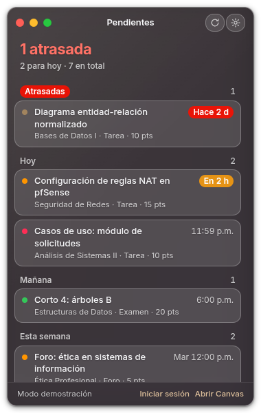
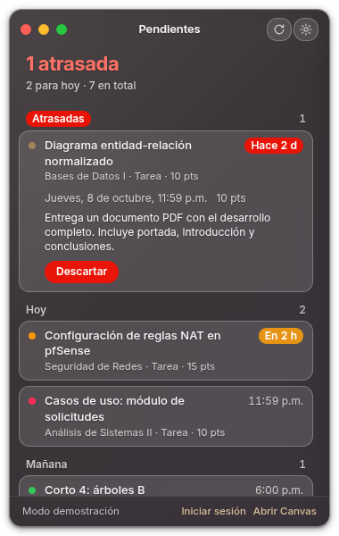
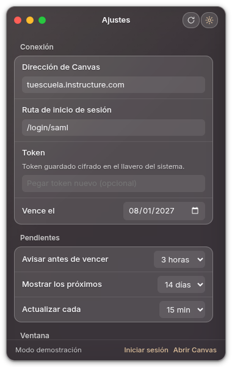

# Canvas Today

Widget de escritorio para Linux y Windows 11 con tus pendientes de Canvas: tareas, exámenes, foros y notas,
agrupados por día, con avisos antes del vencimiento. Interfaz en español o inglés según el idioma del sistema.

<p>
  
  
  
</p>

Descarga la última versión en [Releases](https://github.com/lelrxuch/canvas-today/releases).

## Instalar

### Linux

```bash
chmod +x Canvas-Today-*.AppImage
./Canvas-Today-*.AppImage
```

Si falla por FUSE en Fedora: `sudo dnf install fuse-libs`.

### Windows 11

Ejecuta `Canvas-Today-Setup-<versión>.exe`. Instala solo para tu usuario, sin pedir permisos de
administrador, y deja elegir la carpeta. El vidrio usa el acrílico del sistema (Windows 11 22H2 o posterior)
y el color de acento sale de Configuración → Personalización → Colores.

El instalador no está firmado, así que SmartScreen puede mostrar "Windows protegió tu PC": haz clic en
**Más información → Ejecutar de todos modos**.

El soporte para Windows está en pruebas. Si encuentras un problema, repórtalo en
[Issues](https://github.com/lelrxuch/canvas-today/issues).

## Primer uso

1. Se abre Ajustes.
2. Dirección de Canvas: el dominio de tu institución, p. ej. `tuescuela.instructure.com` (lo que ves en la barra del navegador al entrar a Canvas, sin `https://`).
3. Token: pégalo desde Canvas (Cuenta → Configuración → Nuevo token de acceso). Si venías de una versión
   anterior, el token de `~/.config/canvas-widget/token` se migra solo.
4. Vence el: fecha de vencimiento que elegiste al crear el token.
5. Guardar.

## Cada 90 días

Genera un token nuevo en Canvas, pégalo en Ajustes → Token y actualiza la fecha. La app avisa 7 días antes.

## Archivos

En el directorio `userData` de Electron: `~/.config/Canvas Today/` en Linux, `%APPDATA%\Canvas Today\` en Windows.

- `token.enc` — token cifrado con el llavero del sistema (libsecret/KWallet en Linux, DPAPI en Windows)
- `token` — solo si no hay llavero disponible (Linux): texto plano con permisos 600
- `config.json` — ajustes
- `state.json` — avisos ya enviados

"Iniciar con el sistema" crea `~/.config/autostart/canvas-today.desktop` en Linux; en Windows registra la app
en el inicio de sesión del usuario (`app.setLoginItemSettings`).

La primera vez se migran los archivos de `~/.config/canvas-widget/` (versión 1.0); el token antiguo en texto
plano se borra después de comprobar que la copia nueva se lee bien.

## Atajos

- `Ctrl+N` nueva nota
- `Ctrl+R` actualizar
- `Ctrl+,` ajustes
- `Esc` cerrar la vista actual u ocultar
- Botón verde (Linux) o el del medio (Windows): mantener encima

## Linux (GNOME)

El ícono de bandeja requiere la extensión AppIndicator:
`sudo dnf install gnome-shell-extension-appindicator`, luego cierra sesión y vuelve a entrar.
Sin ella la app funciona igual; para volver a mostrar la ventana, ejecuta la AppImage otra vez.

La app corre siempre en X11: si arranca en Wayland, se relanza sola con `--ozone-platform=x11` (en Wayland
GNOME no deja elegir posición ni mantener encima).

## Desarrollo

```bash
npm install
npm start             # app real
npm run demo          # datos de ejemplo, sin Canvas ni token (CANVAS_TODAY_DEMO=1)
npm test              # pruebas de lógica pura con node:test
npm run lint          # ESLint
npm run format        # Prettier (format:check solo revisa)
npm run dist          # genera la AppImage en dist/
npm run dist:win      # genera el instalador NSIS de Windows en dist/ (desde Linux requiere Wine)
```

### Estructura

```
src/
├── main/                 proceso principal
│   ├── index.js          arranque, ventana, IPC y ciclo de actualización
│   ├── canvas-api.js     cliente HTTP, paginación por header Link, normalizeItem
│   ├── config.js         config.json/state.json, validación de Ajustes
│   ├── token-store.js    token con safeStorage o archivo 600, migración
│   ├── platform.js       todo lo que cambia entre Linux y Windows: vidrio, acento, X11, AppUserModelId
│   ├── color.js          tono dominante y acento con contraste ≥ 4.5:1 (puro)
│   ├── wallpaper.js      fondo de GNOME para el vidrio simulado (solo Linux)
│   ├── notifications.js  avisos de vencimiento y de token
│   ├── tray.js           ícono y menú de bandeja
│   ├── autostart.js      inicio automático (XDG en Linux, login items en Windows)
│   ├── demo.js           datos del modo demo
│   ├── i18n.js           idioma según app.getLocale()
│   └── errors.js         AppError con código
├── preload.js            puente window.canvas (idioma y plataforma)
└── renderer/
    ├── index.html
    ├── renderer.js       DOM y eventos
    ├── agenda.js         agrupación por día, resumen y formato de fechas (puro)
    ├── i18n/es.js, en.js textos de la interfaz
    └── styles.css
test/                     pruebas node:test
```

## Aviso

Proyecto independiente, sin afiliación con Instructure. Canvas es marca de Instructure, Inc.

## English

Desktop widget for Linux and Windows 11 that shows your Canvas to-dos (assignments, quizzes, discussions and
grades) grouped by day, with reminders before they're due.

<p>
  
  
  
</p>

### Install

Download the latest version from [Releases](https://github.com/lelrxuch/canvas-today/releases).

**Linux:** `chmod +x Canvas-Today-*.AppImage` and run it. If it fails because of FUSE on Fedora:
`sudo dnf install fuse-libs`.

**Windows 11:** run `Canvas-Today-Setup-<version>.exe`. It installs for your user only, without admin rights.
The installer isn't code-signed, so SmartScreen may show "Windows protected your PC": click **More info →
Run anyway**.

Windows support is in testing. If you find a problem, please report it in
[Issues](https://github.com/lelrxuch/canvas-today/issues).

### Canvas token

1. In Canvas, go to Account → Settings → New Access Token, and set an expiration date.
2. In the app's Settings, enter your school's Canvas address (e.g. `yourschool.instructure.com`), paste the
   token and set the same expiration date. The app reminds you 7 days before it expires.

### Privacy

The token is encrypted with the system keychain (when available) and is only sent to your Canvas address.
The app has no telemetry and doesn't talk to any other server.

### Disclaimer

Canvas Today is not affiliated with or endorsed by Instructure, Inc. Canvas is a trademark of Instructure, Inc.
